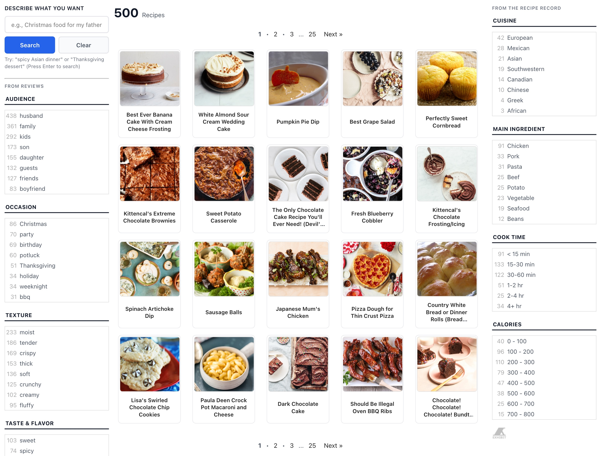
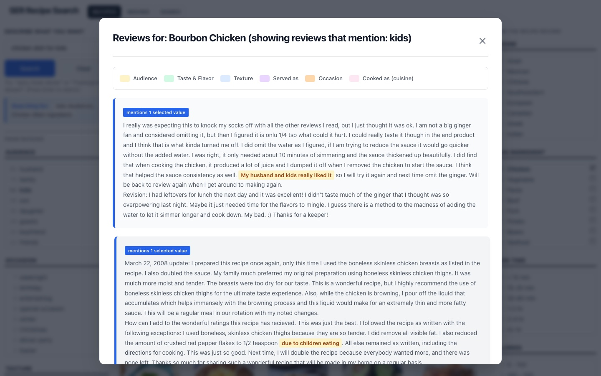

# SER: An Experiential Search and Retrieval System

SER answers searches for properties that catalogs do not record but reviews do, such as whether children will eat a dish. Its core is EXP-DB, which annotates each item with catalog attributes and with experiential attributes extracted from its reviews, each linked to the review span it came from.

- **Live demo:** https://leolee7.github.io/SER/ (recipes, [movies](https://leolee7.github.io/SER/movies/), [games](https://leolee7.github.io/SER/games/))
- **Video:** https://youtu.be/gwKzpr1FuOM

## Demo

The left column holds facets extracted from reviews, the right column facets from the catalog record. Type a need such as "chicken dish for kids"; SER maps its words to facet values and reports which ones it applied. Open a recipe and choose "View Reviews with Highlights" to see the review spans behind each value.





To run it locally, serve this directory and open the root page:

```bash
python3 -m http.server 8080
# then open http://localhost:8080/
```

## Data

| Domain | Items | Reviews | Source |
|---|---|---|---|
| Recipes | 500 | 9,306 | [Food.com Recipes and Reviews (Kaggle)](https://www.kaggle.com/datasets/irkaal/foodcom-recipes-and-reviews), CC0 |
| Movies | 100 | 3,992 | [IMDb Review Dataset (Kaggle)](https://doi.org/10.34740/KAGGLE/DSV/1836923) |
| Games | 100 | 4,000 | [Steam Games Dataset](https://doi.org/10.57967/hf/0511) and [Steam reviews 2020 to 2024](https://doi.org/10.17632/jxy85cr3th.2) |

## Category Settings

For recipes, reviews are extracted into six experiential categories (a single review phrase can belong to several):

| Category (demo label) | What it records | Examples |
|---|---|---|
| **Taste & Flavor** | a specific taste of the dish | tangy, spicy, garlic, not too sweet, mild |
| **Texture** | physical feel in the mouth | tender, crispy, moist, creamy, fluffy |
| **Served as** | the meal or role the dish was served as | dinner, breakfast, dessert, side dish |
| **Occasion** | the event it was served for | Christmas, Thanksgiving, birthday, potluck, weeknight |
| **Audience** | who ate and liked it (not who cooked it) | kids, husband, family, guests, picky eater |
| **Cooked as (cuisine)** | the cuisine the reviewer describes it as | Mexican, Italian, Chinese |

Main ingredient, listed cuisine, cook time, and calories come from the Food.com catalog. The movie and game pages follow the same design with their own categories.

## Pipeline (v4, October 2026)

1. **Extract.** `deepseek-v4-flash` on the NRP Nautilus endpoint (`https://ellm.nrp-nautilus.io/v1`), thinking off, temperature 0.2, with [`rebuild_v4/prompts/extraction_prompt_v2.md`](rebuild_v4/prompts/extraction_prompt_v2.md). Each mention is a category, a value, a sentiment, and the exact source text. The prompt excludes the reviewer as audience, other dishes ("served it with Mexican rice"), planned changes, and cuisine words that name an ingredient or a restaurant.
2. **Ground and verify.** Keep a mention only if its source text occurs in the review, then a second pass ([`verify_prompt_v1.md`](rebuild_v4/prompts/verify_prompt_v1.md)) checks each mention against the category definitions.
3. **Normalize.** An observe-act-apply loop merges variants into canonical values (tart, zesty -> tangy; hubby, DH -> husband; not too spicy -> mild) and blacklists non-attributes. Each round is logged in [`rebuild_v4/normalization/ROUNDS.md`](rebuild_v4/normalization/ROUNDS.md).
4. **Aggregate.** A recipe carries a flavor value when two of its reviews assert it, and a value of another category when one does. A value must apply to at least two recipes.

Every facet value keeps its link to the review span it came from, which the demo highlights. Full log, evaluation, and how to rebuild: [`rebuild_v4/README.md`](rebuild_v4/README.md). The previous version (Gemma 3 extraction) is tagged `v3-deployed-2026-10-24`.
