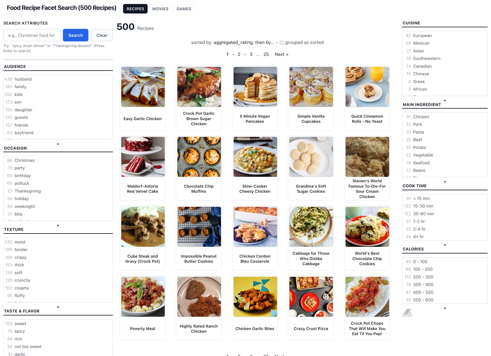
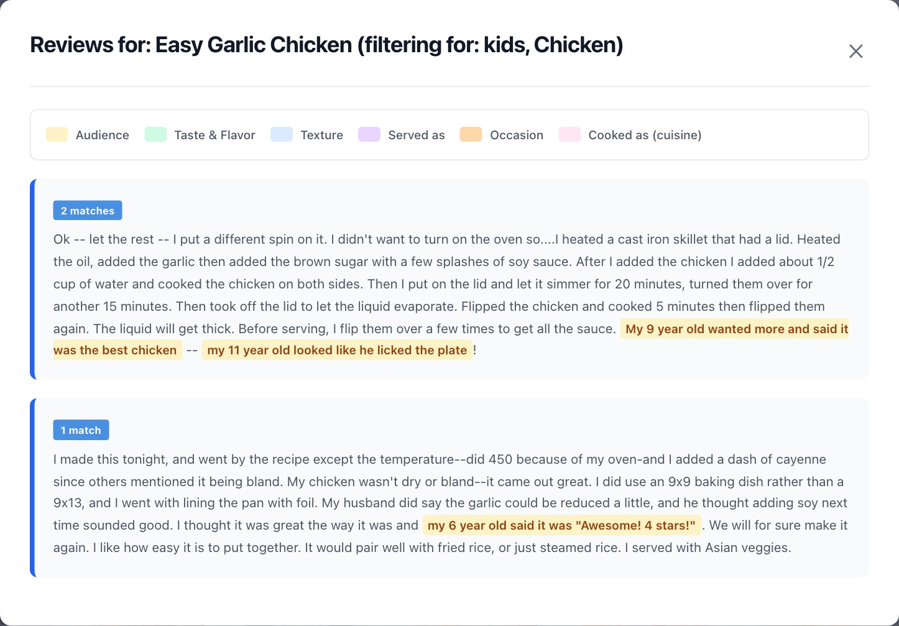
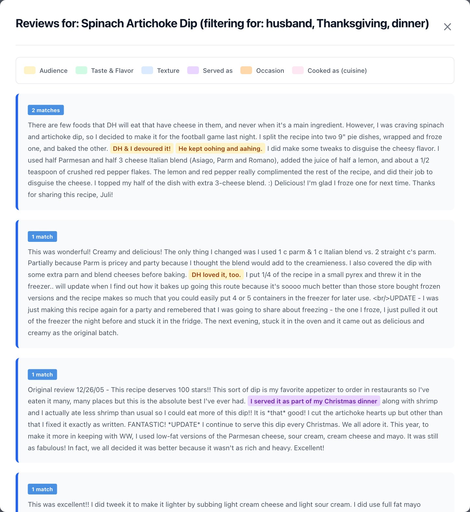
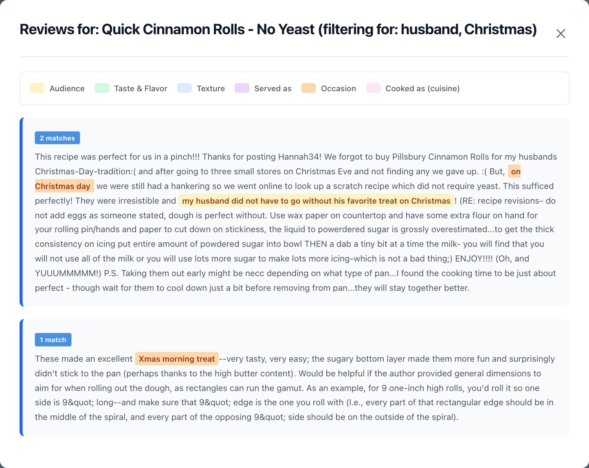

# SER-DB: Subjective Experience Repository

A demonstration of extracting and organizing subjective product needs (SPN) from food reviews using LLM-based attribute extraction.

## Preview the Demo

### Option 1: Using Live Server (VS Code Extension)

1. Install the [Live Server extension](https://marketplace.visualstudio.com/items?itemName=ritwickdey.LiveServer) in VS Code
2. Right-click on `food-exhibit-500recipes.html`
3. Select "Open with Live Server"
4. The page will open automatically in your browser

### Option 2: Using Python HTTP Server

1. Start a local HTTP server in this directory:
   ```bash
   python3 -m http.server 8080
   ```

2. Open your browser and navigate to:
   ```
   http://localhost:8080/food-exhibit-500recipes.html
   ```

3. When done, stop the server with `Ctrl+C`

## Demo Screenshots

### Faceted Search Interface
The main interface allows browsing and filtering recipes across multiple subjective dimensions:



### Review Highlights
Click any recipe to view reviews with color-coded highlighting showing where each attribute was extracted:



### Filtered Reviews - Thanksgiving Example
Filter by specific attributes like "husband" and "Thanksgiving" to see only matching reviews with highlighted spans:



### Filtered Reviews - Christmas Example
Another example showing how filtering works for holiday-specific attributes like "Christmas":



## Data Source

**Original Dataset**: [Food.com - Recipes and Reviews (Kaggle)](https://www.kaggle.com/datasets/irkaal/foodcom-recipes-and-reviews)

- **Full Dataset**: 522,517 recipes with 1,401,982 reviews from 271,907 users
- **Demo Subset**: 500 top-rated recipes with ~10,000 reviews (20 reviews per recipe)
- **License**: [CC0: Public Domain](https://creativecommons.org/publicdomain/zero/1.0/)
- **Academic Use**: ✅ **Freely available for academic research, education, and commercial purposes with no restrictions**

The demo showcases how subjective experiences can be systematically extracted from natural language reviews and organized into a browsable, faceted interface.

## Category Settings

Reviews are extracted into **6 experiential categories** (a single review phrase can belong to several):

| Category (demo label) | What it records | Examples |
|---|---|---|
| **Taste & Flavor** | a specific taste of the dish | tangy, spicy, garlic, not too sweet, mild |
| **Texture** | physical feel in the mouth | tender, crispy, moist, creamy, fluffy |
| **Served as** | the meal or role the dish was served as | dinner, breakfast, dessert, side dish |
| **Occasion** | the event it was served for | Christmas, Thanksgiving, birthday, potluck, weeknight |
| **Audience** | who ate and liked it (not who cooked it) | kids, husband, family, guests, picky eater |
| **Cooked as (cuisine)** | the cuisine the reviewer describes it as | Mexican, Italian, Chinese |

Main ingredient, listed cuisine, cook time, and calories come from the Food.com catalog.

## Pipeline (v4, October 2026)

1. **Extract.** `deepseek-v4-flash` on the NRP Nautilus endpoint (`https://ellm.nrp-nautilus.io/v1`), thinking off, temperature 0.2, with [`rebuild_v4/prompts/extraction_prompt_v2.md`](rebuild_v4/prompts/extraction_prompt_v2.md). Each mention is a category, a value, a sentiment, and the exact source text. The prompt excludes the reviewer as audience, other dishes ("served it with Mexican rice"), planned changes, and cuisine words that name an ingredient or a restaurant.
2. **Ground and verify.** Keep a mention only if its source text occurs in the review, then a second pass ([`verify_prompt_v1.md`](rebuild_v4/prompts/verify_prompt_v1.md)) checks each mention against the category definitions.
3. **Normalize.** An observe-act-apply loop merges variants into canonical values (tart, zesty -> tangy; hubby, DH -> husband; not too spicy -> mild) and blacklists non-attributes. Each round is logged in [`rebuild_v4/normalization/ROUNDS.md`](rebuild_v4/normalization/ROUNDS.md).
4. **Aggregate.** A recipe carries a flavor value when two of its reviews assert it, and a value of another category when one does. A value must apply to at least two recipes.

Every facet value keeps its link to the review span it came from, which the demo highlights. Full log, evaluation, and how to rebuild: [`rebuild_v4/README.md`](rebuild_v4/README.md). The previous version (Gemma 3 extraction) is tagged `v3-deployed-2026-10-24`.

## Demo Features

- **Faceted browsing**: Filter recipes by any combination of extracted attributes
- **Review highlights**: Click recipes to see reviews with highlighted extraction spans
- **Context-aware**: Selected facets filter both recipes and visible attributes
